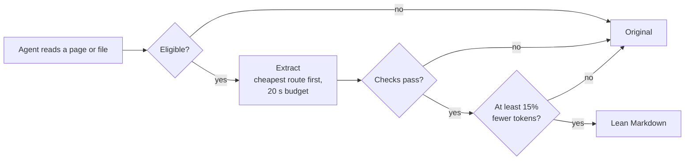

<p align="center"></p>

<h3 align="center">Your coding agent reads the web. Make it read less.</h3>

<p align="center">
Web pages, PDFs, screenshots and Office files, turned into lean Markdown before your agent reads them.<br>
Fewer tokens, same answers, and when a conversion looks wrong, the agent gets the original instead.
</p>

<p align="center">
<a href="#-how-youll-use-it">How you'll use it</a> ·
<a href="#-results">Results</a> ·
<a href="#-install">Install</a> ·
<a href="#%EF%B8%8F-what-leantext-wont-hide">Limits</a>
</p>

- 📉 **Up to 99% fewer tokens** on real pages: PyPI NumPy goes from 92,348 to 755 ([all results](#-results))
- ✅ **21/21 tasks still answered correctly** in end-to-end Claude Code runs with leantext on
- 🔌 **Automatic in Claude Code.** A hook converts the agent's own `Read` and `curl` calls. Nothing to remember.
- 🛟 **Fails open.** Bot walls, weak OCR, missing code or tables, no real saving: the original goes through untouched.
- 🧾 **Shows its receipts.** Every decision is logged with a reason, and `--report` prints tokens before and after.
- 🪶 **Light install.** 39 MB on a Mac, no system packages needed, about 20 seconds on a normal connection.

<p align="center"></p>

## The problem

Your agent opens a web page to answer one question. It gets the navigation bar, the sidebar, the footer, hidden download lists, scripts and markup. Somewhere in there is the answer, and your agent pays to read all of it.

On PyPI's NumPy page, the project description is about 2,000 tokens. The whole page, converted to Markdown the usual way, is **92,348**. Most of it is a hidden list of every file in every release, with security hashes, that you never see in a browser.

**leantext removes that noise before it reaches your agent, checks that nothing important went with it, and tells you what it saved.**

## 🚀 How you'll use it

There are two ways, and most people only need the first.

### 1. Automatically, inside Claude Code

Say yes to the hook during install, restart Claude Code, and keep working as usual. When the agent reads a web page, a scanned PDF or an Office file, leantext converts it first and the agent reads the lean version.

**An example.** You ask Claude Code:

> Check Stripe's docs for creating a customer and add it to our signup flow.

| Without leantext | With leantext |
|---|---|
| Claude runs `curl -s https://docs.stripe.com/api/customers/create` | The hook runs `leantext` on the same URL instead |
| It reads **3,958 tokens**: the page plus its navigation and chrome | It reads **1,194 tokens**: the parameters, descriptions and code samples |
| Writes the code | Writes the same code, after reading 70% less |

If the conversion fails a check, or saves less than 15%, the hook steps aside and Claude reads the original. You never get a worse result than without leantext.

**See what it did:**

```bash
tail -3 ~/.cache/leantext/hook.jsonl     # each decision, with the reason
```

| When the agent does | The hook does |
|---|---|
| `Read page.html`, `Read scan.pdf`, `Read spec.docx` | points `Read` at a cached Markdown conversion |
| `curl -s URL`, `curl -s URL \| grep …`, `wget -qO- URL` | runs `leantext URL` instead, keeping any text filters |
| anything else (source code, `curl -o`, `curl \| jq`, POSTs) | nothing |

By default the hook converts **web pages, scanned PDFs and Office files**, the kinds that win in the [end-to-end benchmark](#end-to-end-in-claude-code). Text PDFs and screenshots are opt-in with `LEANTEXT_HOOK_KINDS=all`. Re-reading the same file in a session returns the original. Turn the hook off anytime with `LEANTEXT_HOOK=off`.

### 2. From the command line

Point it at a URL or a file. Markdown comes out on stdout, so you can pipe it into any tool or paste it into any chat. Add `--report` to see the savings. These examples use the real test files in this repo, so you can reproduce them (counts vary slightly by [token counter](#how-tokens-are-counted)):

**A web page**

```console
$ leantext tests/fixtures/real/pypi-uv.html --report
# uv

An extremely fast Python package and project manager, written in Rust.

*Installing [Trio](https://trio.readthedocs.io/)'s dependencies with a warm cache.*

## Highlights

- A single tool to replace `pip`, `pip-tools`, `pipx`, `poetry`, `pyenv`, `twine`, `virtualenv`, and
more.
…
leantext report  (html, via trafilatura, dropped 47 hidden)
  raw HTML                        158,141  ->    2,501   98% saved
  naive Markdown (whole page)      43,177  ->    2,501   94% saved
```

**A scanned PDF** (no text layer, so leantext reads it with OCR)

```console
$ leantext tests/fixtures/scanned.pdf --report
INVOICE 2026-0417

Bill to: Example Studio Ltd.
Service: API integration, 12 hours
Rate: 95.00 per hour
Total due: 1,140.00

Payment within 30 days of issue.
leantext report  (pdf, via pdf-scanned->ocr)
  pages as images                   2,318  ->       52   98% saved
```

**Everything else works the same way:**

```bash
leantext https://docs.stripe.com/api/customers/create   # any URL
leantext paper.pdf                                       # PDF with a text layer
leantext error.png                                       # screenshot, read with OCR
leantext spec.docx                                       # Word, Excel, PowerPoint (needs the office add-on)
cat page.html | leantext -                               # from stdin
```

Useful flags: `--raw` skips conversion, `--strict` exits with code 3 when the output looks suspicious, `--max-tokens N` caps the output, and `--json` gives structured output for scripts. Full list in the [CLI reference](#cli-reference).

## 📊 Results

Every number here comes from `leantext --report` on real inputs. We show the whole range, including the inputs where leantext saves little.

<p align="center"></p>

| Input | Before | With leantext | Saved |
|---|---:|---:|---:|
| PyPI: NumPy | 92,348 | 755 | **99%** |
| PyPI: uv | 43,177 | 2,501 | **94%** |
| Next.js README | 7,394 | 452 | **94%** |
| Screenshot: rich table | 1,999 | 127 | **94%** |
| Screenshot: rich traceback | 3,063 | 308 | **90%** |
| Stripe API docs | 3,958 | 1,194 | **70%** |
| MDN: Promise | 11,901 | 7,503 | 37% |
| OpenAI Python README | 13,856 | 9,712 | 30% |
| Python tutorial (control flow) | 11,950 | 10,746 | 10% |
| *Attention Is All You Need* (PDF) | 10,168 | 9,838 | 3% |

**"Before" is the honest baseline:** the whole page converted to Markdown, roughly what an agent's built-in fetch already gives it. Against raw HTML the numbers look even bigger (the uv page is 158,141 tokens raw), but no sensible tool feeds raw HTML to an agent. For the PDF, "before" is a plain text dump; against sending the pages as images (37,995 tokens), leantext saves 74%. Screenshot baselines use Claude's published image-size formula.

**Why the range is so wide:** leantext can only remove noise. PyPI pages are mostly hidden download lists, so they shrink by 94 to 99%. A research paper is almost all content, so it barely shrinks, and that's the right result.

### What's kept

Fewer tokens only matter if the content survives. On both PyPI pages, we compared leantext's output word by word against the project description on the page:

| | uv | NumPy |
|---|---|---|
| Project description | **all kept**, including all 85 lines of code examples | **all kept**, 375 of 375 words |
| Hidden download lists, menus, footer | dropped | dropped |
| Sidebar: release date, maintainers, license, supported Python versions | dropped | dropped |

The sidebar is a real loss if your question is about it, so it's listed under [limits](#%EF%B8%8F-what-leantext-wont-hide). The MDN page lost one table, and leantext's checks flagged it rather than passing it off as complete.

### End to end in Claude Code

The real test: the same 7 tasks, run in fresh headless Claude Code sessions with the hook off and on, 3 times each (`python bench/agent_bench.py --repeats 3`).

| Task | Correct, off → on | Input tokens | Cost | Turns |
|---|---|---:|---:|---|
| Fetch a docs page (`curl`) | 3/3 → 3/3 | **−37%** | **−23%** | 3 → 2 |
| Scanned PDF | 3/3 → 3/3 | −3% | **−14%** | 3 → 3 |
| Text PDF | 3/3 → 3/3 | −22% | +16% | 5 → 3 |
| Bot-walled page | 3/3 → 3/3 | 0% | 0% | 2 → 2 |
| Download then grep (`curl -o`) | 3/3 → 3/3 | +9% | −3% | 6 → 7 (hook didn't engage) |
| Screenshot: table | 3/3 → 3/3 | +68% | +34% | 3 → 5 |
| Screenshot: traceback | 3/3 → 3/3 | +20% | +2% | 4 → 4 |

**21 of 21 answers stayed correct.** Web pages and scanned PDFs win clearly. Screenshots *lose* inside Claude Code: an image costs about 2k tokens natively, and one extra agent turn to double-check OCR text costs about 15k. Text PDFs save tokens but cost more, because Claude Code caches native PDF reads cheaply. That's why the hook's defaults are web pages, scanned PDFs and Office files. Full per-run answers are in [`bench/agent_results.md`](bench/agent_results.md).

### Tests and install

| | |
|---|---|
| Test suite | **74 tests pass** on Linux; on macOS 72 pass and 2 RapidOCR tests skip, since macOS uses Apple Vision instead. Every bug found in evaluation became a test. |
| Install size on a Mac | **39 MB** (was 133 MB before Office support and backup OCR became optional) |
| Fresh install time | **about 20 seconds** on a normal connection, plus a one-time 30-second Apple Vision warm-up |

## 📦 Install

```bash
git clone https://github.com/shouvik12/leantext && cd leantext && ./install.sh
```

The installer needs nothing set up beforehand. It installs [uv](https://docs.astral.sh/uv/) if you don't have it, which brings its own compatible Python, then asks two questions:

1. **Add support for Word, Excel and PowerPoint files?** About 40 MB more. You can add it later with `./install.sh --office`.
2. **Set up the Claude Code hook?** Yes is what you want for [automatic mode](#1-automatically-inside-claude-code). It keeps your existing hooks and saves a backup of your settings.

**Prefer a one-liner?**

```bash
uv tool install "leantext[tokens] @ git+https://github.com/shouvik12/leantext"
leantext hook-config     # prints the Claude Code hook block to add to ~/.claude/settings.json
```

**Optional add-ons**, kept out of the default install so it stays small:

| Add-on | Adds | Size |
|---|---|---|
| `office` | Word, Excel, PowerPoint and EPUB files (via MarkItDown) | ~40 MB |
| `ocr` | RapidOCR as a backup OCR engine on macOS (Linux gets it by default) | ~80 MB |
| `anthropic` | Vision fallback for screenshots OCR can't read, and exact Claude token counts. Needs `ANTHROPIC_API_KEY`. | small |

For example: `uv tool install "leantext[tokens,office] @ git+https://github.com/shouvik12/leantext"`.

**Nothing else is required.** On macOS, OCR uses Apple Vision, which is built in. On Linux, it uses RapidOCR. If you have Tesseract (`brew install tesseract`) or Poppler's `pdftotext`, leantext uses them automatically: Tesseract is best on code screenshots, and `pdftotext` on two-column PDFs.

> **Slow install?** Your network's route to PyPI may be congested even when other sites are fast. Try another network, or point uv at a nearby PyPI mirror with `UV_DEFAULT_INDEX`.

> A bare `pip install` into Homebrew's Python fails with `externally-managed-environment`. Use the installer, uv, pipx, or a virtual environment.

To remove everything, run `./uninstall.sh`.

## Why leantext

Converters already exist: MarkItDown, Jina Reader, Firecrawl, Pandoc. leantext uses some of them, and adds what an agent needs on top:

1. **It sits under the agent.** The hook converts reads the agent was already making. You don't rely on the agent remembering to call a tool.
2. **Cost-aware routing.** The cheapest extractor that still works wins. A vision model is paid for only when OCR fails.
3. **It knows when not to convert.** Every output is checked against its source, and anything suspicious goes through as the original.
4. **Measured, not claimed.** `--report` and a public benchmark compare the same questions with and without leantext, including the cases where it loses.

## 🛡️ What leantext won't hide

Smaller context is useful. Incorrect context is not. leantext is built to step aside rather than guess:

- **Checks on every conversion.** Missing code blocks, tables or headings, a missing page title, garbled or near-empty output: any of these marks the result as suspicious.
- **Fails open.** In Claude Code, a suspicious result means the agent reads the original. On the command line, you get a warning, or exit code 3 with `--strict`.
- **Bot walls and JavaScript-only pages** are reported as errors, never returned as "please enable JavaScript" content.
- **Never converted:** source code, config, plain text, lockfiles, diffs and patches. The agent may need them byte for byte.
- **OCR first, vision only if needed.** Screenshots go through OCR. A vision model is used only when OCR is weak and you've set `ANTHROPIC_API_KEY`; `--no-vision` turns it off.

**Known limits.** These are real, and worth checking if your task depends on them:

- **PyPI sidebars** (latest version, supported Python versions, release date) are dropped. Check the page, or run `pip index versions <pkg>`.
- **Client-rendered sites** (React apps, dashboards) ship an empty page shell, so a plain fetch can't see their content. leantext flags this rather than pretending. Live-tab mode, on the roadmap, will fix it.
- **Bot walls** (Cloudflare, PyPI's challenge page) exit with code 2. Save the page from your browser and pass the `.html` file.
- **Some data tables** (Wikipedia, MDN) and **code inside JavaScript components** (react.dev) can be dropped. Both are detected, and the original goes through.
- **OCR flattens code indentation.** It's fine for errors, logs and tables; for code, prefer the source file or vision.

## How it decides



**Flagged as suspicious when:**
- code blocks, data tables or headings in the source are missing from the output
- the page's own title is missing from the top of the output (navigation kept instead of content)
- the output is under 10% of the main-content text, garbled, or empty
- the page is a bot challenge or a JavaScript shell whose content loads at runtime
- PDF text has glued-together words, or the pages are mostly graphics

Every decision is logged with its reason:

```bash
jq -r .reason ~/.leantext/fallbacks.jsonl | sort | uniq -c
```

<details>
<summary><b>Routes per input type</b></summary>

| Input | Route | Fallback |
|---|---|---|
| Web page | drop content hidden by default (`hidden`, `aria-hidden`, `display:none`, unselected tabs) → trafilatura → code blocks restored verbatim with language tags → links made absolute. Sites that serve Markdown to agents (`Accept: text/markdown`) are used directly. | whole-page Markdown with menus trimmed above the title |
| Bot challenge / JavaScript-only page | exit 2 with the reason | — |
| PDF with a text layer | first engine whose output isn't glued together: pdftotext → pypdf → MarkItDown (if installed) | — |
| Scanned PDF | render each page, then the image route | — |
| Office (docx, pptx, xlsx, epub) | MarkItDown (`office` add-on) | pandoc |
| Screenshot | Tesseract if installed, else Apple Vision on macOS, else RapidOCR; cleanup for window shadows, dark backgrounds and small text | vision model if OCR is empty or weak and `ANTHROPIC_API_KEY` is set |
| Anything else | passthrough | — |

</details>

<details>
<summary><b id="cli-reference">CLI reference</b></summary>

```bash
leantext URL|PATH|-  [--report]           # Markdown on stdout, report on stderr
  --raw                                   # skip extraction
  --strict                                # exit 3 on suspicious output
  --no-vision                             # OCR only, never call a model
  --keep-hidden                           # include collapsed tabs and hidden elements
  --max-tokens N                          # hard cap with a visible marker
  --json                                  # structured output for tools
  --no-cache
leantext hook-config                      # print the Claude Code hook block
```

| Exit code | Meaning |
|---|---|
| 0 | Markdown on stdout |
| 1 | Input error: missing file, fetch failed, unsupported input |
| 2 | Extraction failed; nothing usable produced |
| 3 | Extraction suspicious (only with `--strict`; otherwise a warning on stderr) |

| Variable | Effect |
|---|---|
| `LEANTEXT_RAW=1` | disable conversion entirely |
| `LEANTEXT_HOOK=off` | disable the Claude Code hook |
| `LEANTEXT_HOOK_KINDS` | `html,pdf-scanned,office` (default) or `all` |
| `LEANTEXT_OCR` | force an OCR engine: `tesseract`, `apple` or `rapidocr` |
| `LEANTEXT_TOKENIZER` | `anthropic`, `tiktoken` or `estimate` |
| `LEANTEXT_CACHE_DIR`, `LEANTEXT_NO_CACHE=1` | move or disable the cache |

</details>

<details>
<summary><b id="how-tokens-are-counted">How tokens are counted</b></summary>

`--report` always names its counter: Anthropic's `count_tokens` API when `ANTHROPIC_API_KEY` is set (exact for Claude), else tiktoken `cl100k_base`, else characters ÷ 4, labelled *estimate*. That's why the same page can show slightly different numbers on two machines. Image baselines use Claude's documented width × height ÷ 750 after resizing to a 1,568 px long edge.

</details>

## Who it's for

- **AI coding-agent users** who'd rather spend context on their code than on page chrome.
- **Developers reading docs** who want API references and READMEs without the surrounding page.
- **Anyone debugging from screenshots** who wants tracebacks and tables as compact text.
- **People building agent pipelines** who want a conversion layer that reports what it did.

If your inputs are already concise, leantext will save little, and it will tell you so.

## Roadmap

- [x] CLI and router for web pages, PDFs, screenshots and Office files
- [x] Token counting and savings report
- [x] OCR → vision fallback
- [x] Claude Code hook with an end-to-end on/off benchmark
- [x] Fallback gates: edit-safe passthrough, title check, time budget, savings floor
- [x] Slim install: 39 MB on a Mac, optional add-ons
- [ ] A "kept" score in `--report`: code, numbers and links checked against the source
- [ ] MCP server
- [ ] Live browser tabs via CDP/Playwright

## Contributing

Bad conversions are the most valuable reports: send the source, the output, and the task that failed. Each one becomes a fixture in `tests/fixtures/` and an assertion in `tests/test_leantext.py`. OCR confusions get a narrow rule in `extractors/image.py::_FIXES`, never a broad one.

```bash
uv run --extra tokens --extra dev pytest -q tests   # run the test suite
python tests/make_fixtures.py                       # regenerate fixtures
```

## License

Apache-2.0. See [LICENSE](LICENSE).
